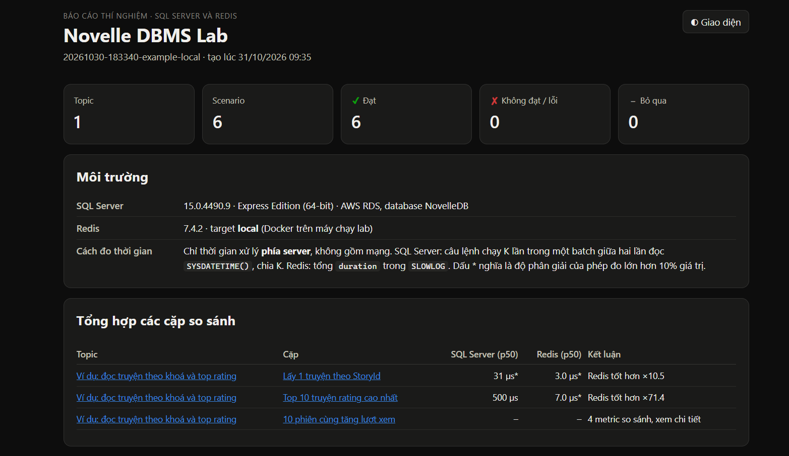
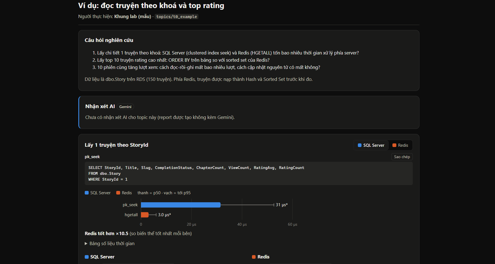

# Novelle DBMS Lab (`category_lab`)

The place where each team member implements their **research topic** for the assignment, on two DBMSs: **SQL Server** (AWS RDS, shared by the whole team) and **Redis**.

Experiments are written as small Python functions called **scenarios**. The lab takes care of the rest:
- connecting to both DBMSs;
- measuring **server-side processing time** (network time is excluded);
- recording statements, execution plans, measurements and verified checks;
- putting the SQL Server and Redis results side by side;
- producing an **HTML report**, with commentary generated by Gemini.

Each topic lives in its own folder, so members work in parallel without touching each other's code.

---

## 1. Setup (once)

Requires **Docker Desktop**. Python and the ODBC driver do not need to be installed on the host.

```bash
cd novelle
cp .env.example .env          # fill in DB_HOST, the RDS passwords and GEMINI_API_KEY (ask the team lead)
docker compose up -d          # start the local Redis
docker compose --profile lab build
```

Every `lab` command runs **inside the lab container**. Open a shell in the container once and run the commands there:

```bash
docker compose --profile lab run --rm lab bash
# working directory: /workspace/category_lab
uv run lab check
```

`lab check` must end with **Sẵn sàng** (ready): both RDS and Redis are reachable. A WARN on the Gemini line is fine; the AI is only used for the commentary in the report.

> Code edited on the host takes effect in the container immediately; no rebuild is needed.
> To run a single command without opening a shell: `docker compose --profile lab run --rm lab uv run lab <command>`.
> Reports are written to `novelle/category_lab/reports/` on the host; open the `.html` file in a browser.

---

## 2. Project structure (what topic authors need)

```
category_lab/
├─ topics/
│  ├─ t0_example/        example topic: read it before writing a new one
│  ├─ _template/         template copied by `lab scaffold` (do not edit)
│  └─ t<number>_<id>/    one folder per topic, e.g. t5_concurrency/
│     ├─ __init__.py     topic metadata: title, owner, research questions
│     ├─ sqlserver.py    scenarios that run on SQL Server
│     ├─ redis.py        scenarios that run on Redis
│     ├─ sql/            .sql files used by the scenarios
│     └─ NOTES.md        the author's notes and conclusions (included in the report)
├─ results/              output of every run (generated, not committed)
├─ reports/              HTML reports (generated, not committed)
└─ lab/                  the lab core (no changes needed)
```

**Rule:** only edit files inside your own topic folder. Requests for new shared tools go to the team lead.

---

## 3. Topic workflow

### Step 1: Create the topic folder

```bash
uv run lab scaffold t5_concurrency --owner "Nguyen Van A" --title "Concurrency control"
```

- The folder name has the form `t<number>_<id>`. The number sets the order in the report; the `id` (here `concurrency`) is the name used by the other commands.
- The command creates every file listed in section 2, including **one scenario pair that runs as is**. It never overwrites an existing folder.

### Step 2: Describe the topic in `__init__.py`

```python
TOPIC = TopicMeta(
    id="concurrency",
    title="Concurrency control",
    owner="Nguyen Van A",
    research_questions=[
        "Concurrent view counting: which DBMS avoids lost updates and handles the load better?",
        "Two admins approving the same author request: which locking mechanism guarantees a single winner?",
    ],
    context="Tables dbo.Story, dbo.AuthorRequest; Redis key views:story:{id} (features F4, F11).",
)
```

The research questions appear in the report and are sent to the AI that writes the commentary, so they should be precise.

### Step 3: Write the scenarios

Each research question should be answered by **a scenario pair**: one function in `sqlserver.py` and one in `redis.py`, with **the same `pair`**. The report places the two side by side. See section 4.

### Step 4: Run and read the results in the terminal

```bash
uv run lab run concurrency                            # both DBMSs
uv run lab run concurrency --dbms sqlserver           # SQL Server only
uv run lab run concurrency -s "concurrency.redis.*"   # filter by scenario id
```

The terminal shows the result of every scenario (`passed` / `failed` / `error` / `skipped`) and a comparison table per pair. A failing scenario does not stop the others; its traceback is shown in the table.

### Step 5: Write `NOTES.md`

Goals, method, conclusions and references. The file is included verbatim in the report.

### Step 6: Build the report

```bash
uv run lab report                                    # report of the latest run
uv run lab report --latest-per-topic --target local  # latest result of every topic: the team report
```

The command prints the path of the file; on the host it is under `novelle/category_lab/reports/`. Section 6 describes the content.

### Step 7: Clean up (when needed)

Temporary tables and keys are removed after every run. After a run with `--keep`, or a run that was interrupted, remove them with:

```bash
uv run lab clean concurrency
```

---

## 4. Writing scenarios

### A minimal scenario pair

```python
# topics/t2_indexing/sqlserver.py
from lab.framework import Ctx, scenario


@scenario(title="Filter stories by rating", pair="filter_by_rating")
def filter_by_rating(ctx: Ctx):
    table = ctx.sandbox_table("Story", "dbo.Story", primary_key=["StoryId"])   # private copy: safe to index
    sql = f"SELECT StoryId, Title FROM {table} WHERE RatingAvg >= ?"

    ctx.bench_sql("no_index", sql, 4.0)          # server-side time
    ctx.inspect_sql("no_index", sql, 4.0)        # logical reads + execution plan

    ctx.sql.exec(f"CREATE INDEX IX_Rating ON {table}(RatingAvg) INCLUDE (Title)")
    stats = ctx.bench_sql("with_index", sql, 4.0)
    info = ctx.inspect_sql("with_index", sql, 4.0)

    ctx.check("Index Seek" in info.plan.physical_ops(), "the plan uses an Index Seek once the index exists")
    ctx.observe(f"With the index: p50 {stats.p50:.3f} ms, {info.logical_reads} logical reads.")
```

```python
# topics/t2_indexing/redis.py
from lab.framework import Ctx, scenario


@scenario(title="Filter stories by rating", pair="filter_by_rating")
def filter_by_rating(ctx: Ctx):
    rows = ctx.sql.query("SELECT StoryId, RatingAvg FROM dbo.Story")
    key = ctx.redis.key("story", "rating")                      # -> lab:indexing:story:rating
    ctx.redis.zadd(key, {str(r["StoryId"]): float(r["RatingAvg"]) for r in rows})

    ctx.bench_redis("zset_range", lambda r: r.zrangebyscore(key, 4.0, "+inf"))
    ctx.inspect_redis_key("zset_range", key)                    # encoding + memory
```

- Scenarios are **discovered automatically**: the `@scenario` decorator is all that is needed.
- The DBMS of a scenario comes from its file name (`sqlserver.py` / `redis.py`), the topic from its folder.
- A metric recorded with **the same name and label** on both sides (e.g. `lost_updates · atomic_update`) is compared directly in the report.

### `@scenario` options

| Option | Meaning |
|---|---|
| `title` | Display name (required) |
| `pair` | Pairs the scenario with the one that has the same `pair` on the other DBMS |
| `targets={"local", "aws"}` | Redis targets the scenario supports. Default: both |
| `destructive=True` | The scenario changes shared data; it only runs with `--allow-destructive` |
| `repeat`, `warmup` | Number of measured runs and warm-up runs for the bench calls (default 20 and 3) |
| `id` | Custom id; the default is `<topic>.<dbms>.<function name>` |

Per-scenario preparation and cleanup (the teardown **always runs**, even when the scenario fails):

```python
@filter_by_rating.setup
def _(ctx): ...

@filter_by_rating.teardown
def _(ctx): ...
```

### Scenario API (`ctx.`)

**Running statements**

| Call | Purpose |
|---|---|
| `ctx.sql.query(sql, *params)` | SELECT; returns `list[dict]`. Parameters use `?` |
| `ctx.sql.scalar(sql, *params)` | A single value |
| `ctx.sql.exec(sql, *params)` | INSERT / UPDATE / DELETE / DDL; returns the affected row count |
| `ctx.sql.exec_file(path)`, `ctx.run_sql_file("sql/x.sql")` | Run a `.sql` file (`GO` batches supported) |
| `ctx.read("sql/x.sql")` | Text of a file in the topic folder |
| `ctx.sql.new_connection(autocommit=False)` | A separate session, e.g. to `COMMIT` / `ROLLBACK` explicitly |
| `ctx.redis.<command>` | Any redis-py command: `get`, `hset`, `zadd`, `pipeline()`, `ft()`, `execute_command(...)` |
| `ctx.redis.key("story", 1)` | Builds the key `lab:<topic>:story:1`. **Always use it**, so lab keys never mix with application data |

**Measuring and inspecting**

| Call | Purpose |
|---|---|
| `ctx.bench_sql(label, sql, *params, inner=None)` | **Server-side SQL Server time**, recorded as metric `server_ms` (p50, p95, min, max). **INSERT / UPDATE / DELETE must pass `inner=1`**: by default the statement is repeated to measure precisely |
| `ctx.bench_redis(label, fn)` | **Server-side Redis time** of `fn(client)`. `fn` must send its commands through the client it receives, e.g. `lambda r: r.hgetall(key)` |
| `ctx.inspect_sql(label, sql, *params)` | Runs once and records `logical_reads`, `cpu_ms` and the **execution plan**. Returns `.plan.physical_ops()`, `.plan.missing_indexes`, `.io`, `.logical_reads` |
| `ctx.inspect_redis_key(label, key)` | Type, encoding (listpack, hashtable, skiplist…), element count and memory (`memory_bytes`) |
| `ctx.metric(name, value, unit, label=, better="lower")` | Any other measurement: lost updates, bytes, deadlocks… `better="higher"` when larger is better |

**Experiment data**

| Call | Purpose |
|---|---|
| `ctx.sandbox_table("Story", "dbo.Story", where=, top=, primary_key=)` | Copies a table to `lab.<topic>__Story` and returns its name. **Mandatory when creating indexes or changing data**: RDS is the team's shared database |
| `fixtures.load_hashes(ctx.redis, rows, "story", "StoryId")` | Loads SQL rows as Hashes `lab:<topic>:story:<id>` (`from lab.framework import fixtures`) |
| `fixtures.load_json(...)`, `fixtures.load_strings(...)` | Same, as RedisJSON documents / Strings holding JSON |

**Concurrent sessions** (Transaction and Concurrency topics)

```python
def work(w, i):                       # w.sql / w.redis are this thread's own connections
    w.sql.exec(f"UPDATE {table} SET ViewCount = ViewCount + 1 WHERE StoryId = ?", 1)

r = ctx.workers(10, work, iterations=20)               # 10 threads start at the same moment
ctx.metric("errors", len(r.errors), "errors", label="atomic_update")
r.error_counts()                                       # e.g. {"sql:1205": 3} = chosen as deadlock victim 3 times
```

- Options: `dbms="sqlserver" | "redis" | "both"`, `autocommit=False` to manage transactions explicitly.
- Errors are collected, not raised; the scenario keeps running.
- Report **counts** (lost updates, conflicts, deadlocks). The duration `r.wall_s` includes the network; use it only to compare runs on the same DBMS.

**Conclusions and evidence**

| Call | Purpose |
|---|---|
| `ctx.check(condition, "statement")` | A verified statement (✔ / ✘). One failed check marks the scenario `failed` |
| `ctx.observe("note")` | The author's conclusion, shown in that DBMS's tab of the report |
| `ctx.statement(label, text)` | Shows a statement in the report. `bench_sql`, `inspect_sql` and `bench_redis` record theirs automatically; call it only for code that does not go through them, such as what `workers` run |
| `ctx.capture(label, content)` | Saves raw evidence (JSON, text, XML) under `results/<run>/raw/` |

Additional inspection helpers (import when needed):
- `lab.framework.sqlserver_probe`: `locks(db)`, `waiting_tasks(db)`, `session_id(db)`.
- `lab.framework.redis_probe`: `memory(...)`, `persistence(...)`, `encoding_thresholds(...)`, `namespace_memory(...)`.

---

## 5. Measurement notes

- **Only server-side time is measured.** The network between the host and RDS does not distort the results, so the two DBMSs are compared fairly.
- A `*` after a value means the measurement is **coarse relative to the value** (resolution above 10%). Differences smaller than the measurement resolution are reported as "equal within measurement error".
- Statements that change data in `bench_sql`: always `inner=1`.
- Never modify `dbo.*` tables: use `sandbox_table`. Redis keys always go through `ctx.redis.key(...)`.
- `--target local` (default) uses the Redis in Docker on the host; `--target aws` uses the Redis on EC2 (the SSM tunnel must be open). SQL Server is always RDS. When building the team report, always pass `--target` so results from the two environments are not mixed.
- The read-then-write lost-update test demonstrates an application bug; present it as an illustration, not as a ranking of the DBMSs.

---

## 6. HTML report





The report is **a single HTML file**: it opens offline, can be attached to the submission and prints to PDF. It contains:

- **Overview:** passed / failed scenario counts, the environment, and a summary table of every comparison pair.
- **Each topic:** the research questions, then every pair:
  - **Comparison:** a timing chart (bar = p50, whisker = up to p95; hover for details), the verdict, and the table of shared metrics.
  - **SQL Server / Redis tabs:** status, AI commentary on that scenario, the statements that ran (with a copy button), the timing table, checks, the author's notes, other measurements and the execution plan (`.sqlplan` files open in SSMS).
- **End of each topic:** the AI comparison of SQL Server and Redis (answers to the research questions, recommendation for Novelle), followed by `NOTES.md`.

The AI commentary is a suggestion only: **check it against the numbers and the author's notes** before using it in the written report. Commentary is cached, so rebuilding a report with unchanged results does not call the AI again.

```bash
uv run lab report <runId>               # report of a specific run (runId = folder name in results/)
uv run lab report --no-llm              # without AI commentary
uv run lab report --refresh-llm         # ask the AI to write the commentary again
```

---

## 7. Commands

| Command | Effect |
|---|---|
| `uv run lab check [--target aws] [--no-sql] [--no-redis]` | Checks connections, permissions, Redis modules and the Gemini key |
| `uv run lab config` | Shows the configuration in use (passwords masked) |
| `uv run lab list [topic]` | Lists topics, owners and scenarios |
| `uv run lab scaffold t<number>_<id> --owner "Name" [--title "Topic title"]` | Creates a new topic folder |
| `uv run lab run <topic \| all> [--dbms sqlserver\|redis] [-s "<id pattern>"] [-n <runs>] [--target aws] [--keep] [--allow-destructive]` | Runs scenarios, prints the results and saves them under `results/` |
| `uv run lab report [runId] [--latest-per-topic] [--target ...] [--out file.html] [--no-llm] [--refresh-llm]` | Builds the HTML report |
| `uv run lab clean <topic \| all>` | Removes leftover `lab.<topic>__*` tables and `lab:<topic>:*` keys |

Append `--help` to any command for all of its options.

---

## 8. Troubleshooting

| Symptom | Fix |
|---|---|
| `lab check` fails on SQL Server | Check `DB_HOST` and the passwords in `novelle/.env` |
| `lab check --target aws` fails on Redis | The SSM tunnel to the Redis on EC2 is not open |
| `no Redis command was recorded` | The function passed to `bench_redis` does not use the client `r` it receives |
| A scenario is `skipped` | It does not support the current target, or it needs `--allow-destructive` |
| AI commentary is empty or shows an error | `GEMINI_API_KEY` is missing, or every model has used up its daily quota; the report is still built, run it again later |
| A `docker ... sh -c '..."..."...'` command fails in PowerShell | Open a shell in the container (`... run --rm lab bash`) and run the command there |
